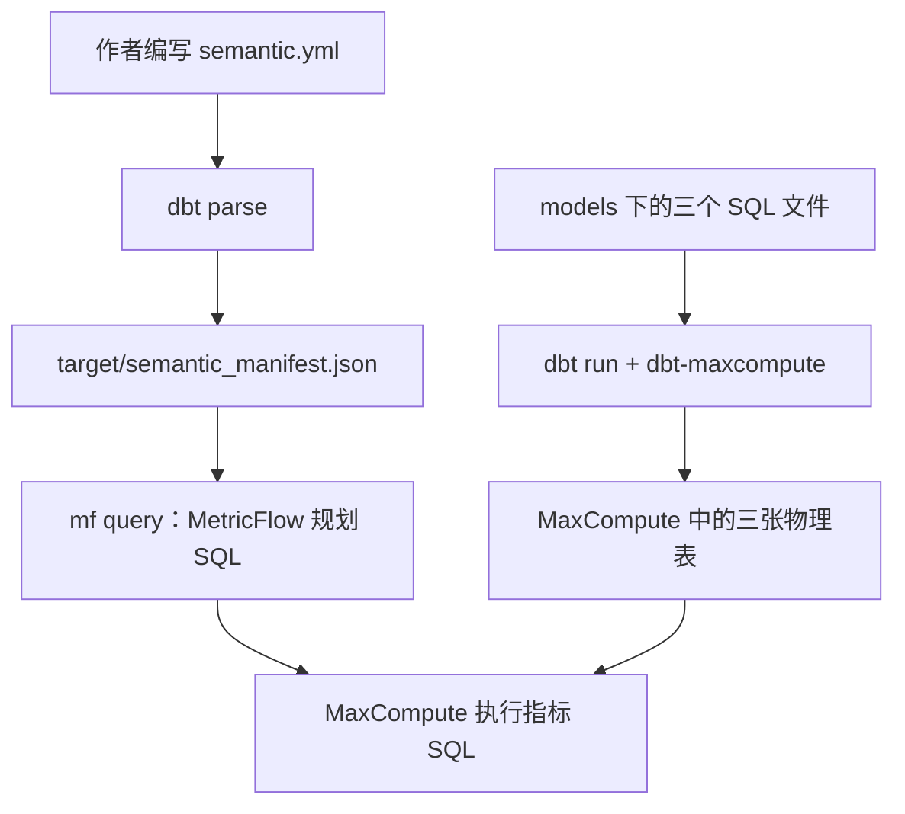

# MetricFlow 试用版快速上手

本试用版把 MetricFlow 指标定义编译为 MaxCompute SQL，并通过 dbt 连接执行。
dbt 负责构建 SQL 数据模型，MetricFlow 负责依据语义定义规划指标查询。
首次试用可先完成第 1～4 步，查看总量、时间分组和维表关联结果。

本包基于 dbt-labs/metricflow 修改，版本带
`+maxcompute.2` 标识。它尚不是 dbt Labs 官方发布的 MaxCompute 支持版本。

包中包含配套核心和 CLI（命令行工具）的 Python wheel 安装包、安装器、运行依赖约束、入门 dbt 项目和可复跑的
31 项 CLI 云端验收。安装器从 wheel 安装，不需要克隆源码、Hatch 或设置 PYTHONPATH。
第三方 Python 依赖仍需从可访问的包索引下载；这不是完整离线安装包。

试用包固定使用以下主版本，完整第三方依赖版本见 `constraints.txt`：

| 组件 | 版本 |
| --- | --- |
| MetricFlow 核心 | `0.214.0.dev0+maxcompute.2` |
| dbt-metricflow CLI | `0.16.0.dev0+maxcompute.2` |
| dbt-core / dbt-adapters | `1.12.6` / `1.24.5` |
| dbt-maxcompute / PyODPS | `1.11.4` / `0.13.2` |

本文命令使用 macOS/Linux Shell 语法。各次发行的平台验收结果见对应 Release 和仓库验收记录；
Windows 尚未列入验收范围。`sources/` 目录附有两个源码发行包，供开发者重建。

## 1. 安装

从 [GitHub Releases](https://github.com/dingxin-tech/metricflow-maxcompute/releases) 下载成套 `.tar.gz` 和同名 `.sha256`，
在 Linux 执行 `sha256sum --check *.tar.gz.sha256`（macOS 使用 `shasum -a 256 --check *.tar.gz.sha256`）。
准备 Python 3.12，解压试用包。在新的终端进入解压目录，执行以下命令，
避免源码开发环境的 Python 路径覆盖已安装的包：

```bash
unset PYTHONPATH PYTHONHOME
python3.12 install.py --venv "$HOME/.venvs/mf-maxcompute-trial"
source "$HOME/.venvs/mf-maxcompute-trial/bin/activate"
python -m pip check
mf --version
dbt --version
```

安装目录必须尚不存在，安装器不会覆盖旧环境。安装前会校验 SHA256，安装后检查
核心和 CLI 版本配套、依赖一致性，以及模块确实来自该虚拟环境。
若需要内网镜像，使用标准的 `PIP_INDEX_URL` 等 pip 配置；不要把镜像或云凭据写入本包。
本试用版已验证 Python 3.12；其他 Python 版本尚未列入交付验收范围。

## 2. 配置 MaxCompute

在当前终端设置下列环境变量。访问密钥建议通过组织现有的凭据注入方式提供：

```bash
export MAXCOMPUTE_PROJECT='<project_name>'
export MAXCOMPUTE_SCHEMA='default'
export MAXCOMPUTE_ENDPOINT='<endpoint>'
export ALIBABA_CLOUD_ACCESS_KEY_ID='<accessKeyId>'
export ALIBABA_CLOUD_ACCESS_KEY_SECRET='<accessKeySecret>'
export MF_MAXCOMPUTE_TABLE_PREFIX="mf_trial_$(date +%Y%m%d%H%M%S)_$$"
```

将尖括号占位符替换为实际值。Endpoint 按项目所在地域选择 HTTPS 地址，
例如上海地域使用 `https://service.cn-shanghai.maxcompute.aliyun.com/api`。
`example/profiles.yml` 从环境变量读取认证信息，
使用 `maxcompute` adapter 和 UTC 会话时区。示例需要建表、写入和读取权限；自动验收
还需要删除本轮测试表。请选择适合创建测试表的项目或 schema。

## 3. 理解并构建三个示例表

本例先构建三张 MaxCompute 物理表，再用 YAML 声明它们的业务含义。
**SQL、表的粒度、实体关系和指标口径都由项目作者编写；dbt 解析这些声明并构建表，
MetricFlow 按声明规划指标查询。** dbt 和 MetricFlow 都不会根据 `customer_id` 这样的字段名自动推断业务关系。

### 3.1 文件分别负责什么

解压后的 `example/` 是一个完整的 dbt 项目，相关文件如下：

```text
example/
├── dbt_project.yml         # 项目名、模型目录、物理表构建方式和表名前缀
├── profiles.yml            # MaxCompute 连接参数，从第 2 节的环境变量读取
└── models/
    ├── orders.sql          # 生成订单数据
    ├── customers.sql       # 生成客户数据
    ├── time_spine.sql      # 生成连续日期
    └── semantic.yml        # 绑定物理模型，声明实体、维度、度量、指标及时间脊柱
```

本例的输入数据直接写在三个 SQL 文件的 `SELECT ... UNION ALL ...` 中，
运行时无需预先准备业务表或导入 CSV。真实项目通常将这些 SQL 改成读取已有业务数据的查询。

| SQL 文件 / dbt 模型名 | 最终物理表名 | 一行代表什么 | 示例数据规模 |
| --- | --- | --- | --- |
| [models/orders.sql](example/models/orders.sql) / `orders` | `<前缀>_orders` | 一笔订单，包含客户、下单时间、金额和分区日期 | 6 笔订单，5 个 `ds` 分区 |
| [models/customers.sql](example/models/customers.sql) / `customers` | `<前缀>_customers` | 一个客户及其区域 | 3 个客户 |
| [models/time_spine.sql](example/models/time_spine.sql) / `time_spine` | `<前缀>_time_spine` | 一天，日期列为 `date_day` | 2026-01-31 至 2026-02-03，共 4 天 |

这里的“前缀”来自第 2 节的 `MF_MAXCOMPUTE_TABLE_PREFIX`。例如它取 `mf_demo` 时，
三张表就叫 `mf_demo_orders`、`mf_demo_customers`、`mf_demo_time_spine`，
落在 `profiles.yml` 指定的 MaxCompute 项目和 schema 中。

### 3.2 dbt 如何把 SQL 文件变成物理表

`dbt_project.yml` 内容如下：

```yaml
name: mf_maxcompute_phase1
version: '1.0'
config-version: 2
profile: mf_maxcompute_phase1
model-paths: [models]
vars:
  table_prefix: "{{ env_var('MF_MAXCOMPUTE_TABLE_PREFIX') }}"
models:
  mf_maxcompute_phase1:
    +materialized: table
    +lifecycle: 1
```

`model-paths: [models]` 告诉 dbt 去哪里找模型。`+materialized: table` 表示将该项目模型的
查询结果保存为物理表，`+lifecycle: 1` 为这些示例表设置一天生命周期。
`table_prefix` 则把环境变量传给各 SQL 文件中的表别名配置。

以 `models/orders.sql` 为例，以下保留了文件中的全部六条数据，仅调整换行：

```sql
{{ config(
    alias=var('table_prefix') ~ '_orders',
    partition_by={"fields": "ds", "data_types": "string"}
) }}

select
    1 as order_id, 1 as customer_id,
    timestamp '2026-01-31 23:59:00' as ordered_at,
    cast(10 as decimal(18,2)) as amount, '2026-02-01' as ds
union all
select 2, 1, timestamp '2026-02-01 00:01:00', 20, '2026-01-31'
union all
select 3, 2, timestamp '2026-02-01 13:00:00', 30, '2026-02-02'
union all
select 4, 999, timestamp '2026-02-02 14:00:00', 40, '2026-02-03'
union all
select 5, cast(null as bigint), timestamp '2026-02-03 15:00:00', 0, '2026-02-03'
union all
select 6, 2, timestamp '2026-02-03 16:00:00', cast(null as decimal(18,2)), '2026-02-04'
```

开头的 `config(...)` 是 dbt 的模板配置：`alias` 决定最终物理表名，`partition_by`
要求按字符串列 `ds` 建分区。后面的 SQL 决定表中的行和列。
执行 `dbt run` 时，dbt 渲染模板，dbt-maxcompute adapter 将查询包装为 MaxCompute 的建表、写入等语句并执行。

`models/customers.sql` 定义三位客户：

```sql
{{ config(alias=var('table_prefix') ~ '_customers') }}

select 1 as customer_id, 'east' as region
union all
select 2, 'west'
union all
select 3, 'unused'
```

`models/time_spine.sql` 定义四个连续日期：

```sql
{{ config(alias=var('table_prefix') ~ '_time_spine') }}

select date '2026-01-31' as date_day
union all
select date '2026-02-01'
union all
select date '2026-02-02'
union all
select date '2026-02-03'
```

这三个 SQL 文件互不引用，因此 dbt 的模型构建依赖中没有订单到客户的关联。
`orders` 与 `customers` 的业务关联将在下一节的语义配置中声明；`dbt run` 不会把两张表预先 JOIN 成一张宽表。
时间脊柱的日期也由作者在 SQL 中提供，dbt 不会自动补出示例以外的日期。

### 3.3 作者如何组织这三张表的语义

`models/semantic.yml` 将物理数据映射为可查询的业务概念。文件名可以自行命名，
本例用 `semantic.yml` 集中保存；其中的 `models`、`semantic_models`、`metrics` 配置各有职责。
下面展示本例配置，自动分区裁剪的 `config.meta` 留在第 5 节解释：

```yaml
version: 2

models:
  - name: time_spine
    time_spine:
      standard_granularity_column: date_day
    columns:
      - name: date_day
        granularity: day

semantic_models:
  - name: orders
    model: ref('orders')
    # 分区映射 config.meta 的配置见第 5 节，此处省略。
    defaults:
      agg_time_dimension: ordered_at
    entities:
      - name: order
        type: primary
        expr: order_id
      - name: customer
        type: foreign
        expr: customer_id
    dimensions:
      - name: ordered_at
        type: time
        type_params:
          time_granularity: day
      - name: ds
        type: categorical
        is_partition: true
    measures:
      - name: revenue
        agg: sum
        expr: amount
      - name: order_count
        agg: count
        expr: order_id
      - name: customer_count
        agg: count_distinct
        expr: customer_id
  - name: customers
    model: ref('customers')
    entities:
      - name: customer
        type: primary
        expr: customer_id
    dimensions:
      - name: region
        type: categorical

metrics:
  - name: revenue
    label: Revenue
    type: simple
    type_params:
      measure: revenue
  - name: order_count
    label: Orders
    type: simple
    type_params:
      measure: order_count
  - name: customer_count
    label: Customers
    type: simple
    type_params:
      measure: customer_count
  - name: average_order_value
    label: Average order value
    type: ratio
    type_params:
      numerator: revenue
      denominator: order_count
```

阅读这份配置时，可以沿着下面的对应关系理解：

| 配置 | 本例含义 | 由谁决定 |
| --- | --- | --- |
| `model: ref('orders')` | 订单语义模型读取 dbt 的 `orders` 模型所对应的物理表 | 作者显式绑定，dbt 解析最终表名 |
| `entities` | `order_id` 标识订单；两个模型通过同名实体 `customer` 连接 | 作者声明主实体、外实体及其字段 |
| `dimensions` | `ordered_at` 可按时间分组，`region` 可按客户区域分组；`ds` 是分区维度 | 作者选择可供分析的字段和类型 |
| `measures` | `amount` 求和、`order_id` 计数、`customer_id` 去重计数 | 作者定义底层聚合口径 |
| `metrics` | 将度量暴露为查询指标，并定义平均订单金额等指标组合 | 作者定义业务指标；MetricFlow 编译查询 |
| `models` 下的 `time_spine` 配置 | 指定 `time_spine` 模型中的 `date_day` 是日粒度的标准时间列 | 作者声明日期表及其粒度 |

`ref('orders')` 引用的是 SQL 文件对应的 **dbt 模型名**，所以即使物理表名带有前缀，这里的
引用仍然写 `orders`。本例恰好也把语义模型命名为 `orders`，实际绑定关系由 `model: ref(...)` 指定。

实体关联的关键是两边都声明了名为 `customer` 的实体：订单侧为 `foreign`，客户侧为 `primary`，
分别映射到各自的 `customer_id` 列。MetricFlow 据此建立可用的关联路径；仅仅两张表都有
`customer_id` 字段，还不足以建立这个语义关联。声明 `primary` 也不等于给数据库加上主键约束，
作者仍需保证客户表的该键唯一，避免关联后放大订单金额。

`defaults.agg_time_dimension: ordered_at` 指定订单度量的默认业务时间。因此
`metric_time__month` 表示按下单时间的月份分组，`--start-time` / `--end-time` 也按该业务时间过滤。
`ds` 则是用于物理分区的到达日期，两者可以跨日；第 5 节再声明它们之间可用于裁剪的映射。

时间脊柱在 YAML 顶部的 `models` 中登记，本例没有为它定义第三个 `semantic_model`，
也没有把它声明成订单实体的外键目标。它为需要时间脊柱的累计、偏移等查询提供连续日期；
普通营收总量或按客户区域分组，无需为了凑齐三张表而关联日期表。
本例仅提供四天日期，接入真实项目时应提供覆盖查询日期及窗口所需范围的连续日历。

这些口径都可以由作者修改。例如 `average_order_value` 被定义为 `revenue / order_count`，
本例结果是 `100 / 6`；由于第六笔订单的金额为 NULL，直接计算 `AVG(amount)` 得到的却是 `100 / 5`。
“平均订单金额”的分母取哪个口径，需要业务定义，dbt 不会自动替作者选择。

### 3.4 用一次区域营收查询串起整条链路

假设用户发出下面的查询：

```bash
mf query --metrics revenue,order_count --group-by customer__region
```

MetricFlow 从指标定义找到 `revenue → SUM(amount)`、`order_count → COUNT(order_id)`，
确定数据来自订单模型。`customer__region` 中的 `customer` 指定实体路径，`region` 指定客户侧维度。
规划器沿已声明的 `customer` 关系找到客户模型，再生成关联与分组聚合 SQL。

为便于理解，等价查询可简化为下面的形式；其中 `<前缀>` 是说明用占位符，实际编译 SQL
会展开完整项目、schema、表名，并可能包含子查询和优化后的表达式：

```sql
select
    c.region as customer__region,
    sum(o.amount) as revenue,
    count(o.order_id) as order_count
from `<前缀>_orders` o
left join `<前缀>_customers` c
    on o.customer_id = c.customer_id
group by c.region
```

从上面的示例数据即可手工推导结果，无需先运行命令：

| customer__region | revenue | order_count | 来源 |
| --- | --- | --- | --- |
| east | 30 | 2 | 客户 1 的两笔订单：10 + 20 |
| west | 30 | 2 | 客户 2 的两笔订单：30 + NULL；求和忽略 NULL，订单仍计数 |
| NULL | 40 | 2 | 客户 999 无维表记录，另一笔订单的客户 ID 为 NULL；金额为 40 + 0 |

客户 3 的 `unused` 区域没有订单，因此这次从订单出发的查询不会生成对应结果行。
本例的 `customer_count` 在订单侧对客户 ID 去重，结果为 3（1、2、999），
并不表示维表中有三位客户实际下单。这些数据特意保留了未匹配客户和 NULL，以展示指标口径与关联行为。

### 3.5 执行构建并生成查询所需的语义文件

前面几节描述的是项目作者已经写好的文件。使用示例时，执行以下命令即可让工具处理这些文件：

```bash
cd example
export DBT_PROFILES_DIR="$PWD"
export DBT_PROJECT_DIR="$PWD"
dbt debug
dbt run
dbt parse
mf list metrics
```

| 命令 | 输入 | 本步骤完成什么 |
| --- | --- | --- |
| `dbt debug` | `dbt_project.yml`、`profiles.yml` 和环境变量 | 检查项目配置与连接 |
| `dbt run` | 三个 SQL 模型及构建配置 | 在 MaxCompute 中创建、写入三张物理表 |
| `dbt parse` | 项目 SQL 与 YAML 定义 | 解析项目，生成或更新 `target/semantic_manifest.json`，此命令本身不建表 |
| `mf list metrics` | `target/semantic_manifest.json` | 列出 `revenue`、`order_count`、`customer_count`、`average_order_value` 四个可查询指标 |
| `mf query ...` | 语义 manifest 和用户请求 | MetricFlow 规划 SQL，经 adapter 在 MaxCompute 中执行并返回结果 |

`semantic_manifest.json` 是从作者声明编译出的语义描述文件，包含模型绑定、实体、维度、度量、
指标和时间脊柱等元数据。它不保存订单数据，也不会额外创建“语义表”。
`mf` 消费这个描述文件，查询时再读取 MaxCompute 中的物理数据。



上图分别展示构建数据表和解析语义声明两条路径；表已存在并不代表业务语义已经定义。
修改指标口径或实体关系后，需要重新解析项目、更新 manifest。
修改 SQL 数据模型后，则需重新构建相关物理表，再更新项目解析结果。

这三张表是短期试用数据，配置了一天生命周期。需要主动清理时，按本轮前缀核对后删除
`<前缀>_orders`、`<前缀>_customers`、`<前缀>_time_spine`，避免删除其他试用或业务表。

## 4. 查询指标

```bash
# 总营收 100，订单数 6，去重客户数 3，平均订单金额 100/6
mf query --metrics revenue,order_count,customer_count,average_order_value

# 按月：2026-01 为 10 / 1，2026-02 为 90 / 5
mf query --metrics revenue,order_count --group-by metric_time__month

# 按客户区域：east 为 30 / 2，west 为 30 / 2，NULL 为 40 / 2
mf query --metrics revenue,order_count --group-by customer__region

# 时间过滤：结果为营收 40、订单数 1
mf query --metrics revenue,order_count --start-time 2026-02-02 --end-time 2026-02-02

# 只查看生成的 SQL；--explain 不执行指标查询
mf query --metrics revenue --start-time 2026-02-02 --end-time 2026-02-02 --explain

# 导出结果
mf query --metrics revenue --group-by metric_time__month --csv monthly.csv
```

维度通过实体路径引用，例如 `customer__region`；`metric_time__month` 表示月粒度。
月份和日期输出可能带 `00:00:00`，取决于 CLI 对 TIMESTAMP 的展示方式。

## 5. 自动分区裁剪

示例订单表按字符串 `ds` 物理分区；语义配置位于 `models/semantic.yml`：

```yaml
config:
  meta:
    maxcompute_partition_mapping:
      time_dimension: ordered_at
      partition_dimension: ds
      time_zone: UTC
      partition_time_zone: Asia/Shanghai
      max_early_arrival_seconds: 32400
      max_lateness_seconds: 86400
      partition_format: yyyy-mm-dd
```

这里声明业务时间按 UTC 解释，`ds` 是上海时区的到达日期，允许提前 9 小时、
迟到 24 小时。因此查询 UTC 的 2 月 2 日，会自动添加：

```sql
ds >= '2026-02-01' AND ds <= '2026-02-04'
```

原有业务时间过滤仍然保留。示例中会扫描五个分区中的四个。
这一配置是覆盖回灌的硬性数据约束，不能用平均或 P99 延迟代替。无法保证迟到上界时，
应删除整个映射配置；只设置 `is_partition: true` 不会自动推导业务时间映射。
支持 `yyyy-mm-dd`、`yyyymmdd` 两种日期格式和 IANA 时区。DST 边界保守扩展，
累计/窗口指标按计划中扩展后的输入时间范围计算分区条件。

`time_zone` 描述已求值业务时间维度的墙上时间和查询入参；它不会改写该维度的时区
表达式或修改 warehouse 会话配置。原始 TIMESTAMP 列的时区应与会话解释一致。
如需其他业务时区，先在时间维度表达式中实现对应的业务时间语义，再声明相符的映射。

## 6. 接入自己的 dbt 项目

保留自己的模型和 `profiles.yml`。先明确事实表的一行代表什么、业务时间取哪一列，
以及维表实体键是否唯一。再按第 3.3 节的结构编写语义 YAML：用 `model: ref('事实模型名')`
绑定已有 dbt 模型，声明实体路径、可分组的维度、聚合度量和对外指标。可从本例的
`orders`、`customers` 和 `revenue` 定义开始修改。

已有 dbt SQL 模型可以复用，但实体关联和指标口径仍需作者显式定义。
新增语义 YAML 本身不会复制业务数据、构建新的宽表或自动校验实体键的唯一性。

执行 `dbt run` 构建模型，再执行 `dbt parse` 更新语义 manifest。在项目根目录运行
`mf`，或通过 `DBT_PROJECT_DIR`、`DBT_PROFILES_DIR` 指向项目和 profile 目录。
累计、偏移等指标还需要在项目中配置覆盖查询日期的时间脊柱。

不要把本示例的测试前缀和一天生命周期直接复制给业务表。

## 7. 重跑完整 CLI 云端验收

回到试用包根目录，使用安装后的 Python 运行：

```bash
python -I verify_cli.py --live --output-root /tmp/mf-maxcompute-evidence
```

脚本使用真实的 `dbt parse`、`dbt run`、`mf list metrics`、`mf query --explain`、
`mf query --csv` 控制台命令，逐项比对 CSV。它会创建带独立 UUID 前缀的十张表，
验证单表、分组、关联、跨事实、自动裁剪、累计/窗口、转化、SCD 和分位数，
并在结束时删除这十张表、检查前缀残留。日志、SQL、CSV、原生执行计划和报告
写入指定的包外目录；凭据只从环境读取。

## 常见问题与支持边界

- 找不到 manifest：在同一项目执行 `dbt parse`，确保存在 `target/semantic_manifest.json`。
  当前读取路径固定为默认 `target`；不要为试用项目改用自定义 target-path。
- VECTOR 元数据解析报错：检查 `python -m pip show pyodps`，确认使用本试用环境的 0.13.2。
- HTTP 连接被重置：使用项目地域对应的 HTTPS Endpoint。
- 前日偏移缺少第一天：上游默认 INNER 时间脊柱关联，没有匹配前日数据的日期会被排除。
- 开启映射仍全扫：使用结构化 `--start-time` / `--end-time`；原始 SQL `--where` 字符串
  不会被解析成自动裁剪范围。用 MaxCompute 原生 EXPLAIN 的 `Data source` 核对实际分区。
- 近似离散分位数、微/纳秒截断明确不支持。图形化 `--display-plans` 需另装可选 Graphviz。
- 当前交付验收是单机 CLI 和小数据云端链路；未包含托管 dbt Semantic Layer、BI 接口、
  多用户服务、生产规模性能或组织权限治理。不能用一次试用验收替代业务数据验收。
- 两个带 `+maxcompute.2` 的包应配套升级；不要直接用官方上游包覆盖其中一个。
  试用期间也不要单独升级 dbt-core；当前验收基于 dbt Core v1，不包含 v2。
